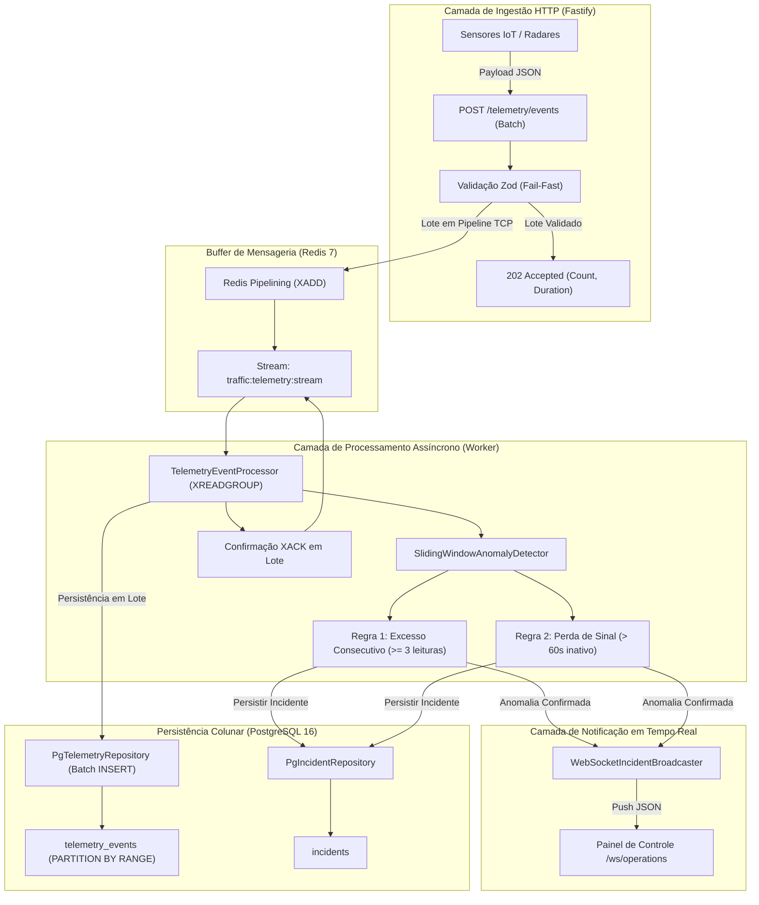

# Traffic Telemetry & Incident Ingestion Microservice

> Microsserviço de alta vazão para ingestão contínua de telemetria veicular, detecção de incidentes de trânsito em tempo real por algoritmo de janela deslizante (*sliding window*), difusão instantânea via WebSocket e persistência colunar particionada em PostgreSQL.

---

## 1. Visão Geral e Propósito do Sistema

O **Traffic Telemetry & Incident Ingestion Microservice** foi projetado para operar como camada central de ingestão de dispositivos IoT, sensores de fluxo viário, câmeras inteligentes e radares rodoviários. 

O objetivo primordial é desacoplar o ciclo de requisição HTTP da persistência em disco, absorvendo picos severos de tráfego (backpressure) através de **Redis Streams**, garantindo:
- **Latência de Ingestão Inferior a 5ms:** Resposta `202 Accepted` imediata para o remetente com validação estrita de contrato via Zod.
- **Detecção Concorrente de Anomalias:** Avaliação de excesso consecutivo de velocidade e perda de conectividade de sensores em memória sem bloquear o Event Loop do V8.
- **Transmissão em Tempo Real:** Disparo imediato de alertas para o painel de operações via WebSockets.
- **Armazenamento Otimizado para Séries Temporais:** Persistência no PostgreSQL particionado por intervalo temporal com índices BRIN.

---

## 2. Diagrama de Arquitetura & Fluxo de Dados



---

## 3. Decisões de Design e Engenharia

### Clean Architecture & SOLID
- **Independência de Frameworks:** As entidades e schemas de domínio (`src/domain/`) não possuem dependências de bibliotecas de infraestrutura externa (Fastify, Redis ou PostgreSQL).
- **Inversão de Dependências (DIP):** O caso de uso interage estritamente com Portas abstratas (`TelemetryPublisherPort`, `TelemetryConsumerPort`, `IncidentBroadcasterPort`, `TelemetryRepositoryPort`). As implementações concretas residem na camada `src/infrastructure/`.
- **Single Responsibility (SRP):** O controlador apenas orquestra o protocolo HTTP, o detector apenas avalia a janela deslizante, e o consumidor gerencia o ciclo de vida do stream.

### Padrões de Concorrência & Performance no Node.js
1. **Redis Pipelining vs Roundtrip Sequencial:** Na ingestão em lote (até 2.000 eventos), a aplicação despacha comandos `XADD` empacotados em um único frame TCP (`pipeline.exec()`). Isso reduz a latência de I/O em até 95% e impede bloqueios do Event Loop.
2. **Stream Capping (`MAXLEN ~ 1000000`):** Limita o consumo de memória do Redis usando poda aproximada ($O(1)$ amortizado), evitando travamento da thread única do Redis.
3. **Isolamento de Conexões do Redis:** Conexões dedicadas para publicação (`publisherRedis`) e consumo bloqueante com grupos (`consumerRedis`), evitando que operações de leitura bloqueante congelem comandos do publisher.

### Padrões de Resiliência & Fail-Fast
- **Validação Defensiva com Zod:** Payloads malformados são interceptados antes de alocações pesadas, devolvendo `400 Bad Request` detalhado.
- **Tratamento de Sobrecarga (Circuit Breaker / 503):** Se a camada de buffer do Redis atingir timeout ou desconexão, o handler global mapeia o erro para `503 Service Unavailable`, sinalizando sobrecarga ao API Gateway/Load Balancer.
- **Encerramento Gracioso (Graceful Shutdown):** Captura de `SIGINT`/`SIGTERM` drena o lote em processamento do worker, encerra o servidor HTTP e finaliza ordenadamente os pools de conexão com Redis e PostgreSQL.

---

## 4. Guia de Execução Local Rápido

### Pré-requisitos
- **Docker** e **Docker Compose** (ou Node.js 22 LTS instalado localmente)

### 1. Variáveis de Ambiente
Crie um arquivo `.env` baseado no modelo disponível:
```bash
cp .env.example .env
```

| Variável | Padrão | Descrição |
|---|---|---|
| `PORT` | `3333` | Porta de escuta da API Fastify |
| `HOST` | `0.0.0.0` | Host de vinculação de rede |
| `NODE_ENV` | `development` | Ambiente de execução (`development` / `production` / `test`) |
| `PG_HOST` | `127.0.0.1` | Endereço do banco PostgreSQL |
| `PG_PORT` | `5432` | Porta do PostgreSQL |
| `PG_DATABASE` | `traffic_telemetry` | Nome da base de dados |
| `PG_USER` | `postgres` | Usuário do banco de dados |
| `PG_PASSWORD` | `postgres` | Senha de acesso |
| `REDIS_HOST` | `127.0.0.1` | Endereço do servidor Redis |
| `REDIS_PORT` | `6379` | Porta do servidor Redis |
| `TELEMETRY_STREAM_NAME` | `traffic:telemetry:stream` | Chave do Redis Stream |
| `CONSUMER_GROUP_NAME` | `traffic-analytics-group` | Nome do Consumer Group |
| `SPEED_THRESHOLD_KMH` | `100` | Limite de velocidade para disparo de infração |
| `CONSECUTIVE_SPEEDING_THRESHOLD` | `3` | Quantidade de leituras consecutivas para confirmar incidente |
| `SIGNAL_LOSS_TIMEOUT_MS` | `60000` | Janela de inatividade sem sinal para alertar queda (60s) |

### 2. Inicialização Completa via Docker Compose
Para subir o banco particionado, o Redis e o microsserviço:
```bash
docker compose up -d --build
```

O PostgreSQL executa automaticamente as migrações e o particionamento temporal montados em `/docker-entrypoint-initdb.d/001_init_telemetry_partitions.sql`.

### 3. Execução em Desenvolvimento Local (Host)
```bash
# 1. Subir serviços auxiliares
docker compose up -d redis postgres

# 2. Instalar dependências
npm ci

# 3. Executar em modo observador com recarregamento a quente
npm run dev
```

---

## 5. Exemplos Práticos da API

### Ingestão em Lote de Telemetria (`POST /telemetry/events`)

**Requisição:**
```http
POST /telemetry/events HTTP/1.1
Host: localhost:3333
Content-Type: application/json

[
  {
    "device_id": "sensor-sp-rod-01",
    "timestamp": "2026-11-08T02:00:00.000Z",
    "event_type": "SPEED_UPDATE",
    "speed_kmh": 118.5,
    "payload": {
      "coordinates": {
        "latitude": -23.55052,
        "longitude": -46.633308,
        "heading_deg": 180.0
      },
      "metadata": {
        "lane": 2,
        "weather": "clear"
      }
    }
  },
  {
    "device_id": "camera-anpr-km45",
    "timestamp": "2026-11-08T02:00:01.000Z",
    "event_type": "INCIDENT_ALERT",
    "speed_kmh": 0.0,
    "payload": {
      "severity": "CRITICAL",
      "coordinates": {
        "latitude": -23.55100,
        "longitude": -46.63400
      },
      "metadata": {
        "obstacle": "STOPPED_VEHICLE"
      }
    }
  }
]
```

**Resposta de Sucesso (`202 Accepted`):**
```json
{
  "statusCode": 202,
  "status": "ACCEPTED",
  "message": "Telemetry batch ingested and queued for stream processing",
  "data": {
    "published_count": 2,
    "stream_name": "traffic:telemetry:stream",
    "duration_ms": 2.14
  }
}
```

**Resposta de Erro de Validação (`400 Bad Request`):**
```json
{
  "statusCode": 400,
  "error": "Bad Request",
  "message": "Validation failed for telemetry batch",
  "correlationId": "req-1",
  "details": [
    {
      "path": "0.speed_kmh",
      "message": "speed_kmh exceeds maximum realistic limit (350 km/h)",
      "code": "too_big"
    }
  ]
}
```

---

### Conexão de Transmissão de Incidentes em Tempo Real (`WS /ws/operations`)

Conecte qualquer cliente WebSocket em `ws://localhost:3333/ws/operations`.

**Mensagem Recebida ao Conectar:**
```json
{
  "event": "CONNECTED",
  "message": "Connected to Operations Incident Stream",
  "timestamp": "2026-11-08T02:00:00.000Z"
}
```

**Exemplo de Incidente Transmitido em Tempo Real:**
```json
{
  "channel": "INCIDENTS_ALERT",
  "data": {
    "incident_id": "550e8400-e29b-41d4-a716-446655440000",
    "device_id": "sensor-sp-rod-01",
    "incident_type": "CONSECUTIVE_SPEEDING",
    "severity": "HIGH",
    "detected_at": "2026-11-08T02:00:05.120Z",
    "details": {
      "description": "Device sensor-sp-rod-01 exceeded speed limit (100 km/h) for 3 consecutive readings.",
      "speed_kmh": 128.0,
      "speed_limit_kmh": 100,
      "consecutive_violations": 3,
      "speed_readings": [112.5, 119.0, 128.0],
      "coordinates": {
        "latitude": -23.55052,
        "longitude": -46.633308,
        "heading_deg": 180.0
      }
    }
  }
}
```

---

### Checagem de Saúde do Serviço (`GET /health`)

**Resposta (`200 OK`):**
```json
{
  "status": "UP",
  "timestamp": "2026-11-08T02:00:10.000Z",
  "active_ws_subscribers": 3
}
```

---

## 6. Scripts e Validação de Qualidade de Código

| Comando | Descrição |
|---|---|
| `npm run typecheck` | Checagem estrita de tipos via compilador TypeScript (`tsc --noEmit`) |
| `npm run build` | Compilação do código de produção para o diretório `dist/` |
| `npm test` | Execução única da suíte de testes unitários e de integração via Vitest |
| `npm run test:coverage` | Geração do relatório de cobertura de testes com motor V8 |

---

## 📄 Licença

Distribuído sob a licença MIT. Desenvolvido por [Viktor Gabriel](https://github.com/ViktorGabriel).
